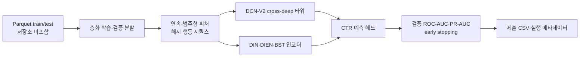

# DCN-V2와 행동 시퀀스 인코더를 활용한 CTR 예측

[English](README.md) · [사례 연구](PORTFOLIO.ko.md)

117개 정형 피처와 사용자의 최근 행동 시퀀스로 광고 클릭 여부를 예측합니다. DCN-V2 스타일 cross/deep 네트워크에 DIN·DIEN·BST 시퀀스 인코더를 교체해 붙여 비교했습니다.

**왜 중요한가.** 클릭은 드뭅니다. 학습 데이터 10,704,179행 중 클릭은 204,179행(약 1.91%)이어서 정확도로는 모델을 구분하기 어렵고, 실제로 클릭될 소수의 행을 얼마나 위로 올리는지가 핵심입니다. 이 순위가 어떤 노출에 광고를 낼지를 정합니다.

**결과.** DCN-V2 + DIEN은 검증 ROC-AUC 0.7413, PR-AUC 0.0792를 기록했습니다(층화 85/15 분할, seed 42, 설정별 1회 실행). 이 PR-AUC는 같은 클릭률에서 무작위 순위가 받는 0.0191의 약 4배입니다. cross 타워 없이 DIN만 쓴 모델도 0.7412 / 0.0779를 기록해, 이번 단일 seed 실행에서는 cross 타워의 뚜렷한 이득이 보이지 않았고 신호의 대부분은 시퀀스 인코더에서 나왔습니다.

이 값은 저장된 검증 지표이며 리더보드나 외부 테스트 점수가 아닙니다. 원본 데이터는 저장소에 없습니다.

## 문제와 분석 흐름

사용자·광고 인벤토리·시간·과거 행동 시퀀스에서 클릭 확률을 추정합니다. 학습 경로는 weighted binary cross-entropy로 불균형을 다루고, 원래 클릭률을 유지한 검증 분할에서 ROC-AUC·PR-AUC로 모델을 비교합니다.



## 구현한 방식

- 연속형 값은 `float32`로 바꾸고, 범주형은 학습 분할에서 만든 매핑과 OOV 인덱스를 사용합니다.
- 행동 이력은 최대 50개로 자르고 padding한 뒤 262,144개 버킷으로 해시해 임베딩 어휘 크기를 제한합니다.
- `DCN_SEQ_Model`은 CrossNetMix, deep MLP, 선택 가능한 DIN·DIEN·BST 관심 인코더를 결합합니다.
- 학습은 seed 42의 층화 85/15 분할, `BCEWithLogitsLoss(pos_weight=negative/positive)`, AdamW, cosine annealing, AUC 기반 early stopping을 사용합니다. 음성 표본을 줄이지 않고 전체 학습 데이터를 씁니다.

설계 선택과 버린 대안은 [PORTFOLIO.ko.md](PORTFOLIO.ko.md#주요-결정)에 정리했습니다.

## 보관된 검증 결과

외부 테스트셋·리더보드 점수가 아니라 저장된 validation metadata입니다. 모든 실행은 전체 학습 데이터, 같은 층화 85/15 분할(seed 42), 최대 3 epoch를 사용했고 설정마다 한 번씩 실행했습니다.

| 실험 | validation ROC-AUC | validation PR-AUC | 근거 |
|---|---:|---:|---|
| 무작위 순위(참고) | 0.5 | 0.0191 | `notebooks/baseline.ipynb` 출력의 클릭률 |
| cross 타워 없는 DIN | 0.7412 | 0.0779 | `results/din_meta.json` (`notebooks/CAT+DIN.ipynb`) |
| DCN-V2 + DIN | 0.7402 | 0.0775 | `results/din_dcnv2_meta.json` |
| DCN-V2 + auto-BST | 0.7403 | 0.0783 | `results/dcnv2_auto_bst_meta.json` |
| DCN-V2 + DIEN | 0.7413 | **0.0792** | `results/dcnv2_dien_meta.json` |
| DCN-V2 + DIEN + DUSIN (full) | **0.7417** | 0.0780 | `results/dcnv2_dien_dusin_full_meta.json` |

- ROC-AUC와 PR-AUC의 최고값이 서로 다른 실행에 있으므로 하나의 우승 모델을 주장하지 않습니다.
- DCN-V2 변형 간 차이는 각 1회 실행 기준 ROC-AUC 약 0.001이며, 반복 seed 없이는 실행 간 편차와 구분할 수 없습니다.
- cross 타워 없는 DIN 실행은 피처 유형 구분도 다릅니다(연속 111 / 범주 6, DCN-V2 실행은 85 / 32). 따라서 cross 타워만 뺀 깨끗한 ablation이 아니라 비교 기준점입니다.

## 실행

원본 Parquet이 없으므로 현재 체크아웃만으로 결과를 재현할 수는 없습니다. 보관된 결과는 노트북에서 나왔고, `src/train.py`는 그 경로를 하나의 CLI로 정리한 리팩터링이며 리팩터링 후 다시 학습하지는 않았습니다(`research/RUN_MANIFEST.md` 참고).

데이터 없이 CLI 확인(`requirements.txt` 패키지 필요):

```powershell
pip install -r requirements.txt
cd src
python train.py --help
```

호환되는 입력 파일로 학습:

```powershell
cd src
python train.py `
  --train_path ..\train.parquet `
  --test_path ..\test.parquet `
  --output_path ..\submit_dcn_seq.csv `
  --meta_path ..\meta_dcn_seq.json `
  --seq_backbone dien
```

입력에는 `clicked` 라벨, `seq` 행동 시퀀스, `ID` 제출 식별자가 필요합니다. `--seq_backbone`은 `din`, `dien`, `bst` 중 하나입니다. `requirements.txt`는 import에서 뽑은 목록이며 원래 패키지 버전은 기록되지 않았습니다. 공통 기본값은 `src/config.py`에 있습니다.

## 한계

- 원본 데이터·외부 테스트 라벨·리더보드 결과·학습 checkpoint가 저장소에 없습니다.
- 설정마다 seed 하나로 실행했고 신뢰구간·calibration·Precision/Recall@K는 기록하지 않았습니다.
- 검증 분할은 시간 순서가 아닌 무작위 층화 분할이므로, 이후 시점 트래픽에서의 성능은 검증하지 않았습니다.
- CLI는 DIN·DIEN·BST 선택만 구현하며, auto-BST 튜닝과 DUSIN 실행은 노트북에만 있습니다.
- 여러 DCN-V2 노트북 로그에서 검증 loss가 `Val nan`으로 출력되지만 ROC-AUC·PR-AUC는 정상 계산됩니다. 원인은 추적하지 않았습니다.
- `main.py`의 LightGBM 피처 엔지니어링 스텁은 `src/train.py`와 다른 경로입니다.

## 문서

- [포트폴리오 사례 연구](PORTFOLIO.ko.md)
- [프로젝트 리뷰](docs/PROJECT_REVIEW.md)
- [아키텍처](docs/ARCHITECTURE.md)
- [실행 매니페스트](research/RUN_MANIFEST.md)
