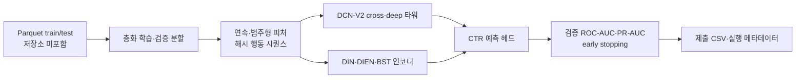

# DCN-V2와 행동 시퀀스 인코더를 활용한 CTR 예측

[English](README.md) · [사례 연구](PORTFOLIO.ko.md)

117개 정형 피처와 사용자의 최근 행동 시퀀스로 광고 클릭률(CTR)을 예측합니다. DCN-V2(Deep & Cross Network v2) cross/deep 네트워크에 DIN(Deep Interest Network), DIEN(Deep Interest Evolution Network), BST(Behavior Sequence Transformer) 시퀀스 인코더를 교체해 붙입니다.

**왜 중요한가.** 학습 데이터 10,704,179행 중 클릭은 204,179행(약 1.91%)뿐이어서 정확도로는 모델을 구분하기 어렵습니다. 실제로 클릭될 소수의 행을 얼마나 위로 올리는지가 핵심이며, 이 순위가 어떤 노출에 광고를 낼지를 정합니다.

**결과.** DCN-V2 + DIEN은 검증 ROC-AUC 0.7413, PR-AUC(정밀도-재현율 곡선 아래 면적) 0.0792를 기록했습니다. 무작위 순위의 0.0191보다 약 4배 높습니다(층화 85/15 분할, seed 42, 설정별 1회 실행). cross 타워 없는 DIN도 0.7412 / 0.0779를 기록해, 신호의 대부분은 시퀀스 인코더에서 나옵니다.

## 접근 방식



- **피처:** 연속형 값은 `float32`로 바꾸고, 범주형은 학습 분할에서 만든 매핑을 쓰며 처음 보는 값에는 OOV(out-of-vocabulary) 인덱스를 씁니다.
- **시퀀스:** 아이템 이력을 50개로 자르거나 padding하고 262,144개 버킷으로 해시해 임베딩 어휘 크기를 제한합니다.
- **모델:** `DCN_SEQ_Model`은 CrossNetMix 층, deep MLP 타워, 선택 가능한 DIN·DIEN·BST 관심 인코더를 결합합니다.
- **학습:** 음성 표본을 줄이지 않은 전체 학습 데이터에 층화 85/15 학습·검증 분할(seed 42)을 적용하고, `BCEWithLogitsLoss(pos_weight=negative/positive)`, AdamW, cosine annealing, AUC 기반 early stopping을 사용합니다. 검증 분할은 원래 클릭률을 유지합니다.

설계 선택과 버린 대안: [PORTFOLIO.ko.md](PORTFOLIO.ko.md#주요-결정).

## 결과

저장된 실행 메타데이터의 검증 지표입니다. 모든 실행은 전체 학습 데이터, 같은 층화 85/15 분할(seed 42), 최대 3 epoch를 사용했습니다.

| 실험 | 검증 ROC-AUC | 검증 PR-AUC | 근거 |
|---|---:|---:|---|
| 무작위 순위(참고) | 0.5 | 0.0191 | `notebooks/baseline.ipynb` 출력의 클릭률 |
| cross 타워 없는 DIN | 0.7412 | 0.0779 | `results/din_meta.json` (`notebooks/CAT+DIN.ipynb`) |
| DCN-V2 + DIN | 0.7402 | 0.0775 | `results/din_dcnv2_meta.json` |
| DCN-V2 + auto-BST | 0.7403 | 0.0783 | `results/dcnv2_auto_bst_meta.json` |
| DCN-V2 + DIEN | 0.7413 | **0.0792** | `results/dcnv2_dien_meta.json` |
| DCN-V2 + DIEN + DUSIN (full) | **0.7417** | 0.0780 | `results/dcnv2_dien_dusin_full_meta.json` |

ROC-AUC와 PR-AUC의 최고값이 서로 다른 설정에서 나오므로, 선택은 운영 지표에 따라 달라집니다.

## 실행

결과는 노트북에서 만들었고, `src/train.py`는 그 파이프라인을 하나의 CLI로 정리합니다.

데이터 없이 CLI 확인:

```powershell
pip install -r requirements.txt
cd src
python train.py --help
```

호환되는 입력 파일로 학습:

```powershell
cd src
python train.py `
  --train_path ..\train.parquet `
  --test_path ..\test.parquet `
  --output_path ..\submit_dcn_seq.csv `
  --meta_path ..\meta_dcn_seq.json `
  --seq_backbone dien
```

입력에는 `clicked`(라벨), `seq`(행동 시퀀스), `ID`(제출 식별자)가 필요하며 나머지 열은 스크립트가 나눕니다. `--seq_backbone`은 `din`, `dien`, `bst` 중 하나입니다. 공통 기본값은 `src/config.py`에 있습니다.

## 한계

- 검증 지표만 있으며 리더보드·외부 테스트·온라인 A/B 결과는 없습니다.
- 원본 데이터와 학습 checkpoint는 포함하지 않아 현재 체크아웃만으로는 결과를 재현할 수 없습니다.
- 설정마다 seed 하나이며, 약 0.001 수준의 ROC-AUC 차이는 실행 간 편차 범위입니다. 신뢰구간·calibration·Precision/Recall@K는 없습니다.
- 시간 순서가 아닌 무작위 층화 분할이므로 이후 시점 트래픽에서의 성능은 검증하지 않았습니다.
- cross 타워 없는 DIN 실행은 피처 유형 구분이 달라(연속 111 / 범주 6, DCN-V2 실행은 85 / 32) 깨끗한 ablation이 아니라 비교 기준점입니다.
- `src/train.py`는 리팩터링 후 다시 실행하지 않았고, auto-BST 튜닝과 DUSIN 실행은 노트북에만 있습니다.
- `requirements.txt`는 import에서 뽑은 목록이며 원래 패키지 버전은 고정되어 있지 않습니다.
- 여러 DCN-V2 노트북 로그에서 검증 loss가 `Val nan`으로 출력되지만 ROC-AUC·PR-AUC는 정상 계산됩니다. 원인은 추적하지 않았습니다.
- `main.py`는 `src/train.py`와 별개인 LightGBM 피처 엔지니어링 스텁입니다.

## 저장소 구성

```text
.
├── src/
│   ├── data.py                 # 데이터셋, 시퀀스 파싱, 해싱
│   ├── models.py               # DCN-V2 스타일·시퀀스 모델 구성 요소
│   └── train.py                # CLI 학습, 검증, 출력 메타데이터
├── notebooks/                  # 저장된 출력이 있는 실험 (results/의 출처)
├── results/                    # 보관된 JSON 실행 메타데이터
└── prior-research/             # 배경 자료
```

## 문서

- [포트폴리오 사례 연구](PORTFOLIO.ko.md)
- [프로젝트 리뷰](docs/PROJECT_REVIEW.md)
- [아키텍처](docs/ARCHITECTURE.md)
- [CV 문장](docs/CV_BULLETS.md)
- [실행 매니페스트](research/RUN_MANIFEST.md)
