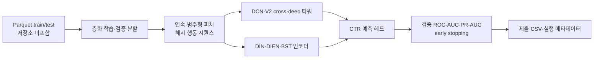

# DCN-V2와 행동 시퀀스 인코더를 활용한 CTR 예측

117개 정형 피처와 사용자의 최근 행동 시퀀스를 함께 써서 광고 클릭률(CTR)을 예측하는 모델입니다. DCN-V2(Deep & Cross Network v2) cross/deep 네트워크에 DIN, DIEN, BST 시퀀스 인코더 중 하나를 바꿔 끼웁니다.

**문제.** 학습 데이터 10,704,179행 중 클릭은 204,179행(1.9%)뿐이라 정확도로는 모델을 구분할 수 없습니다. 중요한 것은 실제로 클릭될 소수의 행을 얼마나 위로 올리느냐이고, 이 순위가 어떤 노출에 광고를 낼지 정합니다.

**결과.** 층화 85/15 검증 분할(seed 42, 설정별 1회 실행)에서 DCN-V2 + DIEN은 ROC-AUC 0.7413, PR-AUC 0.0792를 기록했습니다. 무작위 순위의 0.0191보다 약 4배 높습니다. cross 타워 없는 DIN도 0.7412 / 0.0779여서, 이번 단일 seed 실행에서는 cross 타워의 이득이 확인되지 않았습니다.

**역할.** 이 저장소의 코드·분석·문서를 직접 작성했습니다.

**범위.** 시간순이 아닌 무작위 검증 분할 하나와 seed 하나의 결과이며, 리더보드나 온라인 테스트는 없고 0.001 안팎의 ROC-AUC 차이는 잡음 수준입니다. 데이터와 체크포인트는 포함되어 있지 않습니다. 실행별 지표는 `results/*_meta.json`에 있고, `python src\train.py --help`로 CLI 옵션을 확인할 수 있습니다.

[English](README.md) · [사례 연구](PORTFOLIO.ko.md) · [아키텍처](docs/ARCHITECTURE.md)

## 접근 방식



- **피처:** 연속형 값은 `float32`로 바꿉니다. 범주형은 학습 분할에서 만든 매핑을 쓰고, 처음 보는 값은 OOV(out-of-vocabulary) 인덱스로 처리합니다.
- **시퀀스:** 아이템 이력을 50개로 자르거나 padding하고 262,144개 버킷으로 해시해 임베딩 어휘 크기를 제한합니다.
- **모델:** `DCN_SEQ_Model`은 CrossNetMix 층, deep MLP 타워, 그리고 DIN(Deep Interest Network)·DIEN(Deep Interest Evolution Network)·BST(Behavior Sequence Transformer) 중 하나의 인코더를 결합합니다.
- **학습:** 음성 표본을 줄이지 않은 전체 학습 데이터를 층화 85/15로 나눕니다(seed 42). `BCEWithLogitsLoss(pos_weight=negative/positive)`, AdamW, cosine annealing, AUC 기반 early stopping을 씁니다. 검증 분할은 원래 클릭률을 그대로 유지합니다.

설계 선택과 버린 대안: [PORTFOLIO.ko.md](PORTFOLIO.ko.md#주요-결정).

## 결과

검증 지표입니다. 모든 실행은 전체 학습 데이터, 같은 층화 85/15 분할(seed 42), 최대 3 epoch를 사용했습니다.

| 실험 | 검증 ROC-AUC | 검증 PR-AUC | 출처 |
|---|---:|---:|---|
| 무작위 순위(참고) | 0.5000 | 0.0191 | 클릭률, `notebooks/baseline.ipynb` |
| cross 타워 없는 DIN | 0.7412 | 0.0779 | `results/din_meta.json` |
| DCN-V2 + DIN | 0.7402 | 0.0775 | `results/din_dcnv2_meta.json` |
| DCN-V2 + 자동 튜닝 BST | 0.7403 | 0.0783 | `results/dcnv2_auto_bst_meta.json` |
| DCN-V2 + DIEN | 0.7413 | **0.0792** | `results/dcnv2_dien_meta.json` |
| DCN-V2 + DIEN + 세그먼트 관심 모듈(DUSIN, full) | **0.7417** | 0.0780 | `results/dcnv2_dien_dusin_full_meta.json` |

ROC-AUC 최고값과 PR-AUC 최고값이 서로 다른 설정에서 나오므로, 어떤 설정을 고를지는 운영 지표에 달려 있습니다.

## 실행

결과는 노트북(Python 3.12.11)에서 만들었습니다. `src/train.py`는 그 파이프라인을 하나의 CLI로 정리한 것으로, 원본 데이터로 다시 실행하지는 않았지만 `python scripts\smoke_test.py`가 작은 합성 Parquet 파일로 백본별 1 epoch를 끝까지 실행해 CLI 동작을 확인합니다. 원본 Parquet 파일과 학습된 checkpoint는 저장소에 없습니다. `requirements.txt`는 점검 환경(Python 3.13.2) 버전으로 고정했으며, 원래 실행 때의 패키지 버전은 기록되어 있지 않습니다.

```powershell
pip install -r requirements.txt
cd src
python train.py `
  --train_path ..\train.parquet `
  --test_path ..\test.parquet `
  --output_path ..\submit_dcn_seq.csv `
  --meta_path ..\meta_dcn_seq.json `
  --seq_backbone dien
```

입력에는 `clicked`(라벨), `seq`(행동 시퀀스), `ID`(제출 식별자)가 있어야 하고, 나머지 열은 스크립트가 알아서 나눕니다. `--seq_backbone`은 `din`, `dien`, `bst` 중 하나입니다. 공통 기본값은 `src/config.py`에 있습니다.

## 한계

- 검증 지표뿐이며 리더보드·외부 테스트·온라인 A/B 결과는 없습니다.
- 설정마다 seed가 하나라서, 0.001 안팎의 ROC-AUC 차이는 실행 간 편차 범위입니다.
- 시간 순서가 아닌 무작위 층화 분할이므로 이후 시점 트래픽에서의 성능은 알 수 없습니다.
- early stopping과 보고 점수가 같은 검증 분할을 쓰므로, 보고된 최고 epoch 점수는 낙관적으로 선택된 값입니다.
- 비교 조건이 맞지 않습니다. cross 타워 없는 DIN 실행은 피처 유형 구분이 달라(연속 111 / 범주 6, DCN-V2 실행은 85 / 32) 조건을 맞춘 ablation이 아니라 참고용 비교점입니다.

## 저장소 구성

```text
.
├── src/
│   ├── data.py                 # 데이터셋, 시퀀스 파싱, 해싱
│   ├── models.py               # DCN-V2 스타일·시퀀스 모델 구성 요소
│   └── train.py                # CLI 학습, 검증, 출력 메타데이터
├── scripts/smoke_test.py       # 합성 데이터로 CLI 전체 실행 점검
├── notebooks/                  # 저장된 출력이 있는 실험 (results/의 출처)
├── results/                    # JSON 실행 메타데이터
└── prior-research/             # 배경 자료
```

## 문서

- [포트폴리오 사례 연구](PORTFOLIO.ko.md)
- [아키텍처](docs/ARCHITECTURE.md)
- [실행 매니페스트](research/RUN_MANIFEST.md)

## 라이선스

오픈소스 라이선스 없음: 코드와 문서는 열람용으로 공개하며, 재사용하려면 허락이 필요합니다.
