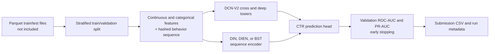

# CTR Prediction with DCN-V2 and Behavior-Sequence Encoders

Ad click-through-rate (CTR) model that combines 117 tabular features with each
user's recent behavior sequence: a DCN-V2 (Deep & Cross Network v2) cross/deep
network plus an interchangeable DIN, DIEN, or BST sequence encoder.

**Problem.** Only 204,179 of 10,704,179 training rows (1.9%) are clicks, so
accuracy says little. What matters is how well a model ranks the few rows that
will be clicked, because that ranking decides which impressions to serve.

**Result.** On a stratified 85/15 validation split (seed 42, one run per
configuration), DCN-V2 + DIEN reaches ROC-AUC 0.7413 and PR-AUC 0.0792, about
four times the 0.0191 of a random ranking. DIN without the cross tower reaches
0.7412 / 0.0779: in these single-seed runs the cross tower adds no measurable
gain.

**Scope.** One random, non-temporal validation split with one seed; no
leaderboard or online test, and ROC-AUC gaps near 0.001 are noise. Data and
checkpoints not included; `results/*_meta.json` holds each run's metrics, and
`python src\train.py --help` lists the CLI options.

[한국어](README.ko.md) · [Case study](PORTFOLIO.md) · [Architecture](docs/ARCHITECTURE.md)

## Approach



- **Features:** casts continuous values to `float32`; maps categorical values
  from the training split, with an out-of-vocabulary (OOV) index for unseen
  values.
- **Sequences:** truncates/pads item histories to 50 items and hashes them into
  262,144 buckets to bound the embedding vocabulary.
- **Model:** `DCN_SEQ_Model` combines CrossNetMix layers, a deep MLP tower, and
  a selectable encoder: DIN (Deep Interest Network), DIEN (Deep Interest
  Evolution Network), or BST (Behavior Sequence Transformer).
- **Training:** stratified 85/15 train/validation split (seed 42) on the full
  training set without negative downsampling;
  `BCEWithLogitsLoss(pos_weight=negative/positive)`, AdamW, cosine annealing,
  and AUC-based early stopping. The validation split keeps the original click
  rate.

Design choices and rejected alternatives: [PORTFOLIO.md](PORTFOLIO.md#key-decisions).

## Results

Validation metrics. Every run uses the full training data, the same stratified
85/15 split (seed 42), and at most three epochs.

| Experiment | Validation ROC-AUC | Validation PR-AUC | Source |
|---|---:|---:|---|
| Random ranking (reference) | 0.5000 | 0.0191 | click rate, `notebooks/baseline.ipynb` |
| DIN without cross tower | 0.7412 | 0.0779 | `results/din_meta.json` |
| DCN-V2 + DIN | 0.7402 | 0.0775 | `results/din_dcnv2_meta.json` |
| DCN-V2 + auto-tuned BST | 0.7403 | 0.0783 | `results/dcnv2_auto_bst_meta.json` |
| DCN-V2 + DIEN | 0.7413 | **0.0792** | `results/dcnv2_dien_meta.json` |
| DCN-V2 + DIEN + segment-interest module (DUSIN, full) | **0.7417** | 0.0780 | `results/dcnv2_dien_dusin_full_meta.json` |

The highest ROC-AUC and the highest PR-AUC come from different configurations,
so the choice depends on the operating metric.

## How to run

Results were produced in the notebooks; `src/train.py` consolidates that
pipeline into one CLI and has not been re-run since. The raw Parquet files and
trained checkpoints are not included.

```powershell
pip install -r requirements.txt
cd src
python train.py `
  --train_path ..\train.parquet `
  --test_path ..\test.parquet `
  --output_path ..\submit_dcn_seq.csv `
  --meta_path ..\meta_dcn_seq.json `
  --seq_backbone dien
```

Inputs need `clicked` (label), `seq` (behavior sequence), and `ID`
(submission identifier); the script partitions the other columns.
`--seq_backbone` accepts `din`, `dien`, or `bst`. Shared defaults are in
`src/config.py`.

## Limitations

- Validation metrics only; no leaderboard, external-test, or online A/B result.
- One seed per configuration; ROC-AUC differences of about 0.001 are within run-to-run noise.
- Random stratified split, not time-ordered; performance on later traffic is untested.
- Comparison conditions are not matched: the no-cross-tower DIN run types features differently (111 continuous / 6 categorical vs 85 / 32), so it is a comparison point, not an ablation.

## Repository layout

```text
.
├── src/
│   ├── data.py                 # Dataset, sequence parsing, and hashing
│   ├── models.py               # DCN-V2-style and sequence model components
│   └── train.py                # CLI training, validation, and output metadata
├── notebooks/                  # Experiments with saved outputs (source of results/)
├── results/                    # JSON run metadata
└── prior-research/             # Background material
```

## Documentation

- [Portfolio case study](PORTFOLIO.md)
- [Architecture](docs/ARCHITECTURE.md)
- [Run manifest](research/RUN_MANIFEST.md)
